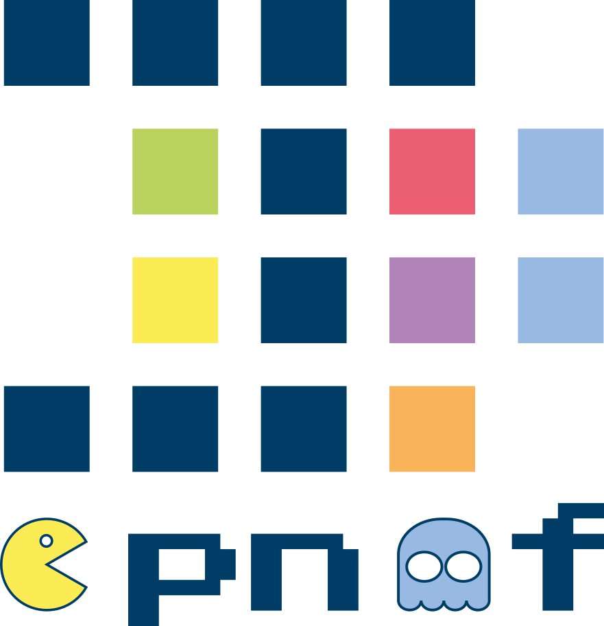

opnmf is a Python implementation of orthogonal projective non-negative matrix factorization, as described by [Yang and Oja (2010)](https://doi.org/10.1109/TNN.2010.2041361).

In neuroimaging, OPNMF is used to find imaging patterns of structural covariance: it splits the brain into a small number of mostly non-overlapping components, which are easy to interpret ([Sotiras et al., 2015](https://doi.org/10.1016/j.neuroimage.2014.11.045)).

```
pip install opnmf
```

- [Documentation](https://juaml.github.io/opnmf)
- [Source code on GitHub](https://github.com/juaml/opnmf)
