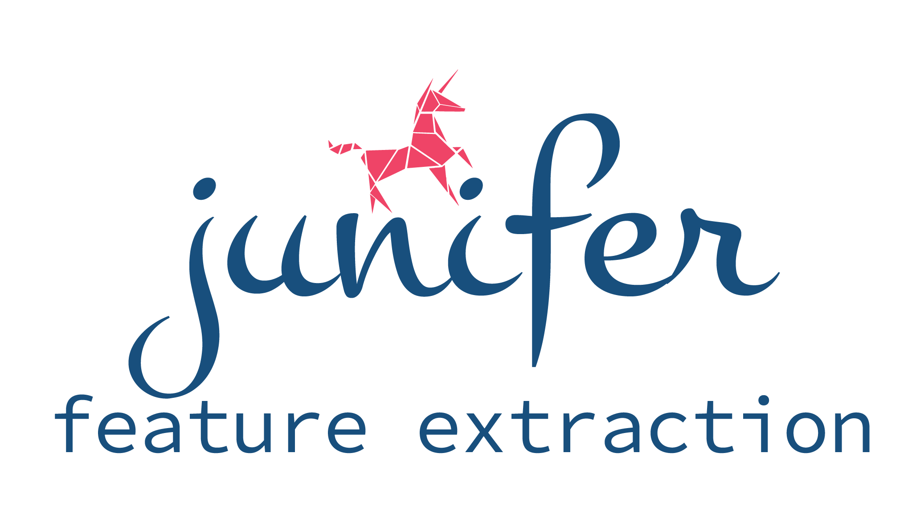

junifer (JUelich NeuroImaging FEature extractoR) is a data handling and feature extraction library for neuroimaging data, especially functional MRI.

It takes care of the steps between raw datasets and machine learning: fetching the data, preprocessing it, computing features (markers) and storing the results. It also includes ready-made configurations for common computing clusters. Each step is a separate, replaceable component, so the library is easy to extend with new datasets and features.

junifer is developed and maintained at the [Applied Machine Learning group](https://www.fz-juelich.de/en/inm/inm-7/research-groups/applied-machine-learning-aml) at Forschungszentrum Jülich.

```
pip install junifer
```

- [Documentation](https://juaml.github.io/junifer)
- [Source code on GitHub](https://github.com/juaml/junifer)
- [Cite via Zenodo](https://doi.org/10.5281/zenodo.8176570)
